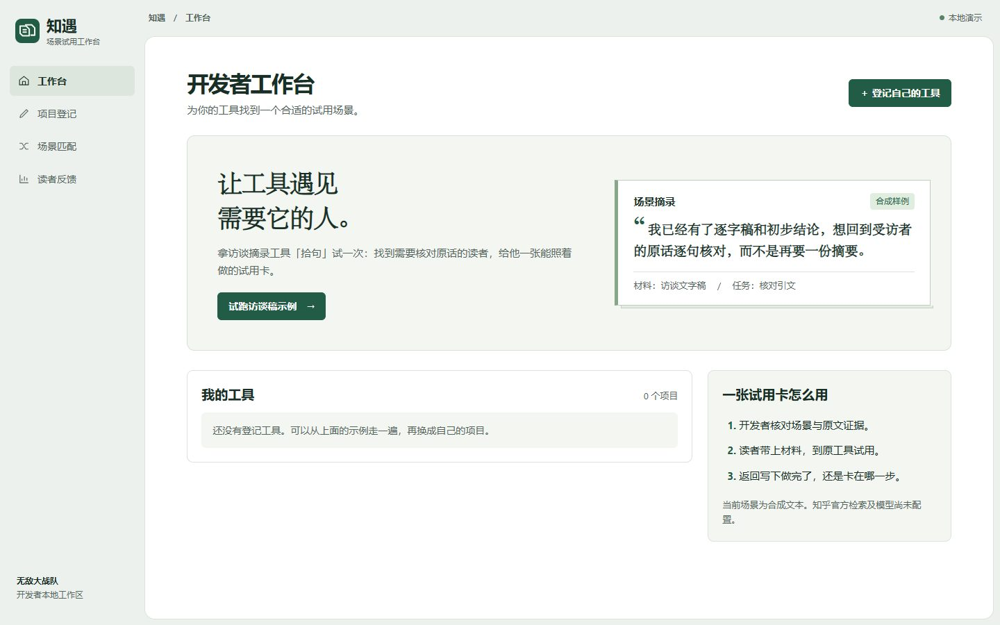

# 知遇 · 让工具遇见需要它的人

这是黑客松 v3 方案的**本地可运行首版**。开发者登记自己已有的 AI 工具，匹配的是读者的使用场景。读者凭独立链接打开试用卡、去原工具做一个任务并反馈。



## 运行与演示

需要 Python 3.10+，不需要 pip、npm、网络或密钥。Windows 双击同目录的 **启动知遇.cmd**；也可在项目目录执行：

```powershell
python server.py --open
```

默认地址 http://127.0.0.1:4173/ 。请始终使用同一主机名与开发者浏览器，localhost 与 127.0.0.1 的 Cookie 不共享。端口冲突可用 `python server.py --port 4180 --open`。用 Ctrl+C 停止服务。直接双击 HTML 或使用静态服务器无法调用接口。

1. 在工作台点 **试跑访谈稿示例**。示例工具“拾句”接收脱敏的文字访谈稿；对照两个场景的证据，查看为何推荐核对引文、排除音频转写。也可登记自己的工具。
2. 在适配场景点 **选这个场景做卡片**。编辑材料、步骤、完成标准及反馈问题，预览并发布。发布是保存到本机，不会发帖。
3. 打开版本化的读者链接，也可复制到同一台机器的另一浏览器。点 **打开原工具试用**，可在示例工具内查找、定位候选原话；切回卡片，选“做完了”或“卡住了”，回答该卡的问题。
4. 回工作台看 **读者反馈**，按项目和版本切换。访问、进入工具、自报完成分别计数；重复点击与提交不重复计数。可从场景页查看旧版本及撤回公开链接。

## 数据从哪里来

- **本地真实运行**：SQLite 保存项目、运行、不可变的发布快照、会话计数和反馈。初始没有访问量和用户反馈。看板来自实际的本地操作。
- **合成样例**：三个问答场景均为本项目编写，可打开样例全文，证据片段可在全文定位。没有伪造的知乎链接、作者或匹配百分比。规则依据输入及预期任务筛选，最多三条，可能为空；并非模型推理。示例原工具按字符重合度挑选文本行，不能判断引文是否支持结论。读者文字稿仅在示例工具的浏览器内处理。
- **尚未接入**：知乎官方检索、真实模型排序、知乎站内分享、账号体系和公网部署。点击“检查真实模式”会保留项目并返回 `not_configured`。新工具若无相应样例，显示空结果。
- **使用范围**：程序只监听本机回环地址。开发者身份为当前浏览器的本机会话，不能当作正式登录；清除 Cookie 后无法再用原会话管理项目。读者计数按浏览器会话和版本去重，不代表独立自然人。
- 数据默认保存于 `var/zhiyu.sqlite3`，不会进入 Git。可通过 `ZHIYU_DB` 指定测试副本。备份用 SQLite 的 backup API 或停服后复制完整数据目录，不要提交读者数据。

## 团队接手

| 模块 | 当前入口 | 下一步 |
| --- | --- | --- |
| F1 开发者工作台 | app.js 的 home / edit / match / cardEditor | 用实际工具和长文本复核 |
| F2 读者与看板 | drawReader / feedbackForm / dashboard | 开展手机真人试用 |
| B1 场景筛选 | fixtures.py 的 SOURCES / rank | 接官方授权检索和模型；保留真实证据与失败状态 |
| B2 数据与发布 | server.py、API.md | 部署前补正式身份、HTTPS、限流策略和备份恢复演练 |
| P 产品验证 | 上面的四步脚本 | 获取真实授权样本和试用反馈，核对站内分享入口 |

接口与三类匹配样例见 [API.md](API.md)。`python -m unittest -v test_flow` 使用临时数据库与独立 Cookie 测试，不写工作区的实际数据。
